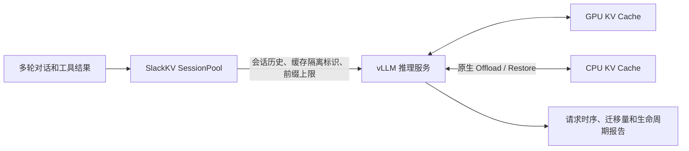

# SlackKV

**面向多轮 LLM 应用的 KV Cache 管理工具，基于 vLLM 原生 CPU offload。**

多轮对话在工具调用后恢复时，往往会再次提交相同的长历史。SlackKV 在 CPU 缓存预算固定时，为每个会话限制可写入的历史前缀，让多个会话有机会保留并复用各自的上下文。项目提供可运行的 Python CLI、真实多轮对话、服务启停、策略对照和回放报告。

[本机快速体验](#快速体验) · [安装与运行](docs/INFRA_OPERATIONS.md) · [架构与源码](docs/INFRA_ARCHITECTURE.md) · [实测数据](results/README.md) · [文档导航](docs/README.md)

## 工作原理



**StaticFair** 将 CPU KV 预算按预设会话槽位均分，并对齐到 16-token 块。每个会话只能把自己的连续历史前缀写入 CPU 缓存。例如预算能容纳 8,192 tokens、预设 2 个槽位时，每个会话最多写入 4,096 tokens。续接时由 vLLM 尝试复用可用前缀，再计算缺失部分。该上限约束写入，实际驻留由原生缓存管理器决定。

| 模式 | CPU KV 写入 |
| --- | --- |
| **StaticFair** | 固定每会话前缀上限 |
| **Full** | 按原生 LRU 管理，允许写入完整前缀 |
| **NoHost** | 关闭 CPU offload，保留 GPU 前缀缓存 |

SlackKV 实现会话与前缀准入、末轮写入控制、服务进程管理和报告。vLLM 提供模型执行、KV 分配、LRU 和数据搬运。实现边界见[工程架构](docs/INFRA_ARCHITECTURE.md)。

## 已验证的行为

| 验证 | 观察 |
| --- | --- |
| [真实多轮 Demo](results/infra_engineering_20261016/runs/e1_demo2/summary.md) | 两个交叠会话各三轮，真实输出进入下一轮历史，客户端执行本地工具查询。 |
| [KV 内容校验](results/infra_engineering_20261016/runs/e1_host3/oracle.json) | 受压场景下从 CPU 恢复 1,792 个额外前缀 tokens，输出 token IDs 与独立冷启动一致。 |
| [断流与清理](docs/INFRA_E2_STATUS_20261016.md) | 首段响应后断流，未完成的轮次未写入历史，新会话 generation 可继续，独立停止验证了自有进程清理。 |

在单卡 RTX A6000、Qwen2.5-1.5B-Instruct 的一次[受限 CPU 缓存对照](results/infra_engineering_20261016/comparison-host-limited.json)中，相同冻结输入与输出 token 数下，整段负载耗时为 **NoHost 3.779 秒、Full 3.590 秒、StaticFair 3.369 秒**。三种缓存压力场景各执行了一次匹配对照，这些数据用于工程验证，稳定加速幅度仍待重复测量。

## 快速体验

在仓库根目录用 Python 3.11+ 执行。以下步骤检查配置并用保存的真实记录重建报告，无需 GPU 或下载模型。

```bash
python -m slackkv.infra doctor --config configs/local.json --config-only
python -m slackkv.infra report --directory results/infra_engineering_20261016/runs/e1_demo2 --output .tmp/reader-report
```

报告生成在 `.tmp/reader-report/`。希望安装 CLI、运行测试或启动真实服务时，见[安装、运行与排障](docs/INFRA_OPERATIONS.md)。真实服务目前验证到 Linux 单机单卡、Qwen2.5-1.5B-Instruct 及固定 vLLM/CUDA 组合。

## 仓库导览

| 在找什么 | 入口 |
| --- | --- |
| 核心实现 | [`slackkv/infra/`](slackkv/infra/) · [会话](slackkv/infra/sessions.py) · [配额](slackkv/infra/config.py) · [原生适配](slackkv/infra/native.py) |
| 基准与回归 | [配置](configs/) · [CPU 测试和生命周期回归](tests/) |
| 可复现结果 | [工程验证](results/infra_engineering_20261016/summary.md) · [原始数据索引](results/README.md) |
| 历史研究 | [32B 对照](docs/AUTONOMOUS_RESEARCH_LARGE_MODEL_20261012.md) · [M1 复盘](docs/RESEARCH_DIRECTION_AFTER_M1.md) · [实验记录](docs/experiment_log.md) |
