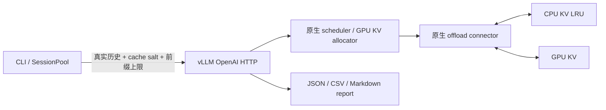

# SlackKV

基于 **vLLM 原生 CPU KV offload** 的单机多会话缓存准入与观测原型。工程主线是固定槽位的 StaticFair 前缀准入，提供真实聊天、本地工具、进程管理和可读报告。推理调度、KV allocator、复制 kernels 和 DMA 均来自 vLLM；本项目不宣称自研推理引擎或生产 SLA。



## 快速开始

CPU 自检无需 GPU、torch、模型或网络：

```bash
python -m pip install -e '.[test]'
slackkv doctor --config configs/local.json --config-only
python -m pytest tests/test_infra.py -q
# 无GPU也能从已保存的真实记录重建报告；输出到新目录，保留历史文件。
slackkv report --directory results/infra_engineering_20261016/runs/e1_demo2 --output .tmp/reader-report
python scripts/verify_infra.py --directory results/infra_engineering_20261016 --output .tmp/reader-verification.json
```

真实服务目前限定 Linux、单卡、Qwen2.5-1.5B-Instruct full attention，固定栈：Python3.11、vLLM distribution0.23.0+cu126、PyTorch2.11.0+cu126、transformers5.17.0，已用RTX A6000/CUDA12.6/driver550.54.14。其他版本、模型或硬件不能由CPU自检推定兼容。

### 准备固定 runtime

先在独立环境安装匹配编译库。已有实验环境可复用编译库，**不复用旧研究调度器Python文件**。全新机器的源码构建命令是安装路径，不冒充已经在干净机器端到端重建验证：

```bash
git clone https://github.com/vllm-project/vllm.git vllm-source
git -C vllm-source checkout 0fc695fc6
# 在独立Python3.11环境按该提交的CUDA构建要求安装；不要升级现有服务器环境。
# VLLM_TARGET_DEVICE=cuda VLLM_VERSION_OVERRIDE=0.23.0+cu126 python -m pip install ./vllm-source
# 核对torch/CUDA版本；本项目doctor会拒绝未验证的package版本。

# UPSTREAM是固定源码checkout；COMPILED是匹配编译库所在根目录，含vllm/_version.py及*.so。
slackkv prepare-runtime --source "$UPSTREAM" --compiled "$COMPILED" --target "$PWD/.runtime/native"
export SLACKKV_MODEL=/absolute/path/to/local/Qwen2.5-1.5B-Instruct
export SLACKKV_RUNTIME="$PWD/.runtime/native"
slackkv doctor --config configs/local.json
```

`prepare-runtime` 校验完整上游Python树hash、编译版本标记和目标manifest；同参数重复执行只校验，不重复覆盖。它不联网、不编译、不下载模型，不原地修改现有 vLLM。源码、生成版本文件、编译库分别记录hash。匹配固定revision的官方源码也可由codeload tar取得。模型应先下载至本地；运行阶段开启离线模式。

### 运行两会话真实三轮 demo

```bash
# 仅在已有适用GPU授权时初始化一次；init-budget本身不授予计算权限。
slackkv init-budget --ledger "$PWD/results/infra_engineering_20261016"
slackkv demo --config configs/local.json --ledger "$PWD/results/infra_engineering_20261016" --name my-demo-unique
slackkv report --directory results/infra_engineering_20261016/runs/my-demo-unique
```

demo 自行启动服务、等待ready、运行两个交叠会话各三轮、生成报告并清理owned进程；真实生成结果进入下一轮历史，遵守EOS。第二轮由客户端查本地JSON文档并将结果提供给模型，**不是模型自主选择工具**。输出含真实消息、工具事件、逐请求时间、完整配置、server日志和执行/清理状态。

也可以前台启动服务，按Ctrl+C或从另一终端给验证过身份的owner发停止信号：

```bash
slackkv serve --config configs/local.json --ledger "$PWD/results/infra_engineering_20261016" --name my-service-unique
slackkv stop --directory results/infra_engineering_20261016/runs/my-service-unique
```

`stop`只给具有匹配进程出生时间的owner发信号，由owner清理自己的process group。单run含启动/清理最多30分钟；本次工程E1–E3共用0.5GPUh上限，所有run/失败/启动/清理共用同一账本，不因换名称重置。`RUNNING`或清理未确认会阻止下一次启动。默认本机绑定，拒绝占用端口或非空闲GPU，不停止其他服务。

## 三种模式

`--policy fair|full|nohost` 覆盖集中配置的policy；其余资源保持不变。

| 模式 | 行为 |
|---|---|
| NoHost | 真正不配置offload connector，GPU APC保留 |
| Full | 原生host LRU，全量允许写入；已知terminal请求仍使用公共gate |
| StaticFair | 相同host预算，以16token物理块按固定最大槽位均分连续前缀额度；每槽位上限固定 |

空槽和短会话未用额度不借出；超过客户端槽位立即明确拒绝，无隐式等待队列。`cache_salt`隔离session/generation，不提供跨会话共享优惠。上限是写入准入，不是物理硬分区或即时驱逐保证。动态M1继续保留在`slackkv/m1`及历史专用runner，**不属于此干净runtime的可切换主线**；不调参，不引入M2/M3。

## 会话与已知限制

- 同一个SessionPool内同会话只允许一个在途请求；不同会话可交叠。它是客户端协议约束，绕过客户端直接请求vLLM或多个独立Pool不会获得全局槽位隔离，不是多租户网关。
- `session_id`可读；`generation`是该Pool内的递增生命周期；每个请求有独立client/native request_id。进程重启产生新epoch/salt，内存历史丢失，从客户端历史重建需新身份正常Prefill。
- 超时/断开不提交半个assistant；失败会话需close后重建generation。客户端取消检查发生在SSE读取边界，不能保证立即终止或已确认native abort。
- 已知最后一轮的terminal gate只抑制新写入，已有读取仍正常。独立close是**逻辑关闭**；物理KV随native LRU和在途结算释放，没有用假推理请求冒充控制API，也没有宣称close即释放。
- 真实demo不要求host命中。GPU热命中不算offload收益；自由生成可能改变后续工作量，不能据此排名吞吐。
- 指标缺失保留UNKNOWN；并发区间仅报告全局计数。首段SSE文本时延与输出平均区间代理不等于engine纯计算或逐Token TPOT分布。

独立受压内容检查使用同资源、batch_invariant=true配置：

```bash
slackkv verify-host --config /path/to/oracle-config.json --ledger "$PWD/results/infra_engineering_20261016" --name host-check-unique
```

它与真实聊天/性能分开：固定8K文本、16K不相干压力、不清GPU、真实H2D/source计数，以及独立cold的完整输出IDs/区分性密码。若资源不足以造成该固定检查的压力，明确拒绝，不自动调整预算寻找命中。

## 历史与工程状态

已完成E1真实纵向流程、E2可靠性/观测/三策略smoke、E3打包与阅读材料。入口：

- [交付清单与验证范围](docs/INFRA_DELIVERY_20261016.md)
- [架构和上游边界](docs/INFRA_ARCHITECTURE.md) · [安装、复现与排障](docs/INFRA_OPERATIONS.md)
- [30秒/3分钟讲解与追问](docs/INFRA_INTERVIEW.md) · [亲自动手清单](docs/INFRA_HANDS_ON.md)
- [E1实际记录](docs/INFRA_E1_STATUS_20261016.md) · [E2实际记录](docs/INFRA_E2_STATUS_20261016.md)

已保存2会话×3轮真实对话与受压内容检查，九次冻结输入benchmark覆盖三用途/三策略；真实首段断流后历史保持原子、换generation恢复，独立停止确认清理。host受限的单次工程smoke中，NoHost/Full/StaticFair全序列分别3779/3590/3369ms，Fair H2D322MiB、D2H224MiB；不是稳定性能或生产SLO声明。GPU热场景没有host恢复，不归因于offload。

工程交付与原始记录放在 `results/infra_engineering_20261016/`，15次run（含1次失败）累计0.1454743GPUh，均确认清理。CPU单测不是GPU证据；未实测的安装/模型组合明确不承诺。压缩日志/指标可直接读取或用gzip展开；`report --output`从归档重建到新目录，避免覆盖历史。`bench-prepare`、`bench`、`bench-compare`和`reliability`的完整命令见操作指南。

此前32B StaticFair在一次合成匹配筛选中E2E相对NoHost−16.44%，不代表所有配置：[原报告](docs/AUTONOMOUS_RESEARCH_LARGE_MODEL_20261012.md)。动态M1局部CPU修补未转为整体收益：[负结果](docs/SLACKKV_SYSTEM_M1_COST_20261013.md)。历史报告、原始数据和研究工具均保留；最新工程目标见[交接](docs/INFRA_ENGINEERING_HANDOFF_20261016.md)。
