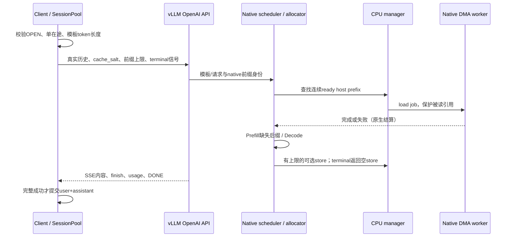
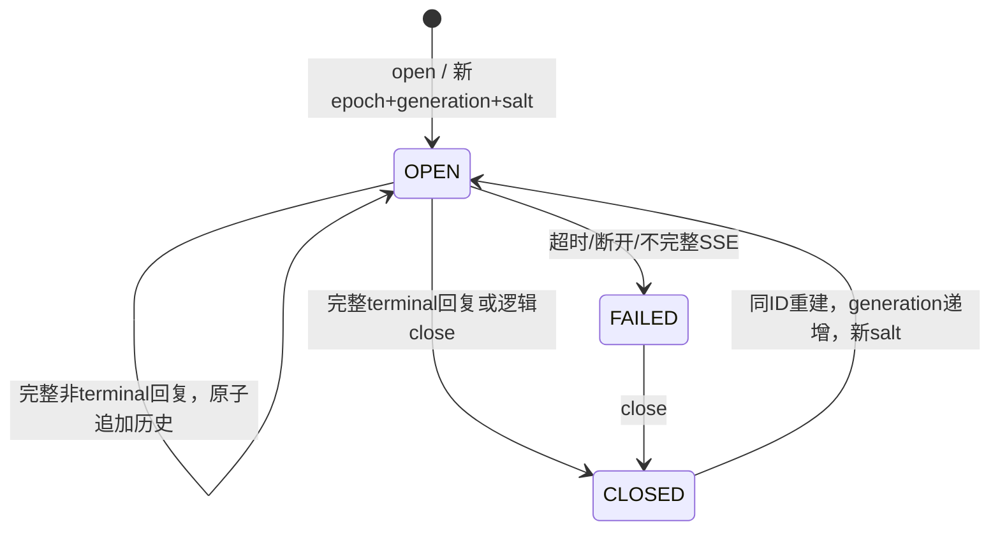

# SlackKV 工程架构与代码边界

范围：Linux单机单卡、固定版本vLLM、受测Qwen2 full-attention。面向可运行/可理解的infra原型；不是自研推理引擎或生产多租户平台。

## 组件职责

| 组件 | 本仓库新增 | 上游提供 |
|---|---|---|
| CLI/配置/doctor | schema与资源约束、固定源码与版本检查、入口与归档 | NVIDIA查询接口、Python打包 |
| ManagedService | ready/超时/owned身份/停止确认/连续工程计费 | vLLM进程及HTTP服务 |
| SessionPool | 槽位、generation/salt、单在途、历史原子提交、逻辑close | 真正的模型推理、HTTP断开后的engine处理 |
| StaticFair | 按固定槽位算对齐前缀上限，附加max_offload_tokens | 原生cap解释、prefix lookup、去重、LRU和store/load jobs |
| InfraCPUSpec | 验证受支持布局；terminal只跳过可选新写入 | CPUOffloadingSpec/Manager、GPU allocator、worker复制与引用 |
| 报告/benchmark | 原始数据、指标口径、固定输入工作量与对照检查 | 原生Prometheus源计数/传输统计、CUDA执行优化 |

主线**不使用旧研究scheduler**。`prepare-runtime`从固定上游`0fc695fc6`复制Python，校验完整树hash；从匹配版本复用编译库并逐一hash。无源码补丁，原生factory加载项目spec。动态M1只保留为旧实验组件，不暗中进入StaticFair。

## 一次真实请求

已在GPU命中的前缀长度为L，CPU连续可用前缀至K时，恢复的是额外连续部分，而不是把K重复加载一遍。例如E1真实受压检查L=2304、K=4096，实际host恢复1792tokens；1.5B FP16每token28672bytes，对应49MiB。密码在3018:3023，确实来自host恢复区间。真实结果见[oracle](../results/infra_engineering_20261016/runs/e1_host3/oracle.json)。

模型forward、GPU块分配、DMA stream/events和job完成机制全部属于vLLM。项目通过原生准入参数减少可选写入，不接管kernel、读写指针或allocator。

## StaticFair和容量语义

TP1/full-attention FP16下，`bytes/token = 2(K/V) × layers × KV_heads × head_dim × 2bytes`。16token为一个准入块，host预算先向下对齐，再给固定最大槽位均分整数块，余块给前面的槽位。默认224MiB/2槽位，1.5B对应每槽4096tokens。

- 空槽和短历史不借出额度；超出槽位立即拒绝，不形成无限队列。
- `max_offload_tokens`是每请求连续前缀的写入上限，**不是CPU物理硬分区/驻留承诺**。
- session和generation使用不同cache_salt，不计跨会话共享root。旧共享机制测试保留，但主线不声称支持任意DAG。
- Full/StaticFair使用相同原生connector/host预算和terminal gate；NoHost无connector，仍启用GPU APC。NoHost是系统配置对照，不隐藏其内部布局差异。

## 生命周期、安全与失败

`pending`是独立客户端请求标志；同一Pool内同会话不能同时send或在pending时close。HTTP失败不会写入半个assistant，不能在不确定旧请求状态时原身份重试。`close`只给逻辑确认；没有从客户端跨进程无锁修改manager，也没有假推理控制请求。

terminal gate不影响查找和已有load，只有prepare_store返回空可选写入。原生pending store/read引用不可提前释放，结算后成为可回收状态；缓存仍可能留至LRU/缓存重置/服务退出。早期工程CPU审计和既有M1引用回归不能外推任意模型或任意取消路径。

客户端实际关闭流与server及时abort不同。E2检查断开后历史不提交、新generation可用、scheduler idle可观察；不把自然完成误称显式abort确认。

## 进程与预算

父CLI持有family文件锁，检查历史未结算run、剩余额度、端口及选中GPU。child通过独立process group启动，记录PID和Linux出生时间。ready失败、body异常或watchdog都进入owned cleanup；终止后检查非zombie成员和GPU释放。PID身份不符拒绝发送信号。

SIGTERM/SIGINT请求停止记STOPPED并确认清理；watchdog/工作流失败记FAILED。清理未确认保持RUNNING，阻止后续GPU运行。失败与启动/编译/清理都计费，同一个工程grant上限0.5GPUh；历史研究预算不挪用。并发控制器异常时不先阻塞等待HTTP reader，而是先退回owned service清理，避免timeout后线程池延迟退出。

## 指标口径

原始requests保留issue/first-content/done，客户端TTFT使用首个非空SSE内容。输出区间除以token数只作平均间隔代理；不称TPOT分布或纯GPU时间。session E2E覆盖首请求至最后完整回复，真实demo含客户端工具步骤。

Prometheus仅采原生全局计数；没有session_id高基数label。并发区间的全局差不可当单请求归因。缺失值为null/UNKNOWN；只有NoHost配置或明确新服务零迁移预热等独立零起点才可证明零，必须记录依据。配置host容量不等于实际占用、RSS或memory-time，当前未观测即UNKNOWN。

## 建议阅读顺序

`config.py` → `sessions.py` → `http.py` → `native.py` → `service.py` → `workloads.py` → `benchmark.py` / `report.py`。再查看真实run数据和测试。vLLM完整源码依赖由runtime manifest与固定commit定位，不需要先读全部历史实验目录。
