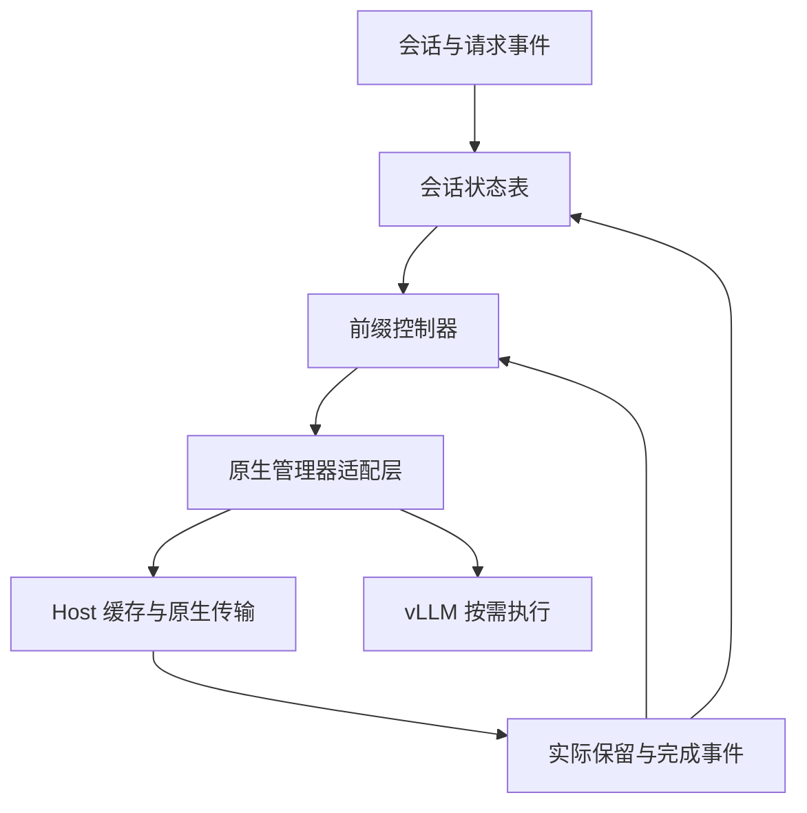

# SlackKV 分阶段系统架构与执行交接

2026-10-12；基线 `322e944af7a4f3b5690f9bab17b555c6e941313c`。

## 0. 当前指令与交付方式

用户已同意把讨论的系统架构交给执行Codex，**一步一步实现，优先快速、稳定落地**。允许复用已有成熟方法；不要求每个模块原创。当前优先级从重复原32B配置转为完成系统能力，不把反序/多种子大矩阵作为开发前置条件。历史结果、10%门槛和局限不改写。

本文件是可演进的设计，不是已实现功能或新性能声明。执行侧可自主选择数据结构、模块位置、小范围接口补丁和最小验证方法；若发现设计与实际原生语义冲突，记录原因并采用更简单安全的实现。不要只更新计划：先完成可运行的第一个里程碑，记录验证与限制，提交推送后交接，再逐步扩展。

**本次第一交付目标：动态前缀管理＋原生按需offload，覆盖非均匀长度和成员变化。** 预取不属于第一交付必要条件。最终研究目标仍是Agent KV管理的端到端收益，不以“模块更多”替代实测价值。

## 1. 系统边界与复用基础

保留已跑通的compiled vLLM、原生OffloadingConnector、相同模型/TP布局及KV内容格式。Full、真实NoHost、StaticFairPrefix继续作为独立可运行配置。第一版不迁移整个项目到LMCache，不修改Attention、GPU allocator或请求优先级，不加入量化、NVMe或peer GPU层。当前两A6000用于TP2，不能同时把另一张卡算为空闲cache tier。

| 层 | 职责 | 实施来源 |
|---|---|---|
| 推理执行 | Prefill/Decode、GPU分配、APC | 当前compiled vLLM |
| 搬运和生命周期 | 查找、异步load/store、引用、完成/失败通知 | 当前原生connector/manager，复用经过检查的路径 |
| 会话状态 | 成员、请求generation、输入prefix身份、需求和实际保留深度 | 新增轻量元数据 |
| 前缀控制 | 基本份额、弹性借用、安全尾部回收 | 第一版核心 |
| 压力反馈 | 区分容量充足与持续失效，防止反复切换 | 第二阶段 |
| 可选恢复计划 | 已知请求的有界预取与干扰反馈 | 第三阶段，默认关闭 |

既有测试只覆盖部分生命周期，不能声称新回收已自动正确。compiled/native APC/传输接口是工程基础，不是新增创新。旧固定GPU pin、credit和soft epochs没有证明整体收益，不默认启用。

## 2. 控制流

这是目标组件关系，不是要求建立新进程/微服务。优先在现有scheduler/connector进程内维护小规模控制元数据，沿用既有TP控制路径。

建议控制点（仅概念接口，不假称原生API已有）：
- `observe_session_event(...)`：成员与上下文变化。
- `plan_store(...)`：返回块对齐的准入上限和本次plan版本。
- `select_reclaimable_tail(...)`：提出可回收候选，原生manager最终检查并执行。
- `on_transfer_complete(...)`：确认写入、加载、失败和实际释放。
- `snapshot_metrics()`：区分目标、实际驻留与在途状态。

先定位实际native hook；小范围扩展原生host eviction/victim选择可接受，不另建与原生物理状态脱节的模拟缓存。

## 3. 第一版：基本份额＋弹性扩展

### 3.1 会话与需求

显式session ID只用于公平计费，不能代替缓存身份；KV身份继续包含原生prefix hash、模型/布局和隔离语义。区分session结束与单请求结束：工具等待不能直接删除会话。第一版优先让受控客户端发送加入/结束事件，活动超时只作可配置回收启发式，不能声称精确预测未来。

维护session的当前观测长度、目标深度、实际连续已完成深度、在途写入/读取、最近活动与plan generation。不要把输出token数量当成已经得到可复用身份的完整KV块。不要假定当前未来请求会无限保持同一条prefix。

### 3.2 块级分配

以实际可管理的host物理块为容量单位，沿用TP全局预算语义，避免按rank再次放大预算。

从已知需求出发做简单max-min分配：短会话达到自身需求后，将剩余块轮转分配给未满足需求的会话；余数轮转，避免永远偏向固定最后一个成员。容量足够时目标深度自然达到完整已知输入；容量不足时保留每个会话可分得的连续前缀。

逻辑上分为：
- 基本份额：当前成员的公平目标，不是永久pin或绝对保留保证。
- 弹性部分：超过基本份额的连续扩展，优先被回收。
- 未分配空间：尚未分给需求的余量，不能把在途保护块也算进来。

第一版不强制设基本/弹性固定百分比，不训练预测模型、不重新使用长度平方cost-tail。对相同需求应能退化到接近现有静态均分；不要求任意负载都比静态策略更快。

### 3.3 目标配额不等于物理状态

`max_offload_tokens`只能限制后续写入，不能回收此前数据。必须同时处理：
1. 会话加入/需求变化时重新计算目标，但不立即假装腾出容量。
2. 先选超额会话最深的可回收尾块，回收必须由原生manager确认。
3. 只用确认可用的容量接受新增store；尚未释放的load/store引用形成暂时的回收欠账。
4. 若不能安全回收，暂缓可选写入，不阻塞整个推理队列、不强制释放被引用块。
5. 扩大目标时，只写GPU中真实存在且原生路径允许保存的块；不存在的后缀等下次正常计算，不伪造缓存，不默认额外重算填池。

准入决策尽量在请求首次有效lookup时冻结，后续chunk和抢占恢复沿用plan，避免一次请求因额度更新反复写/拒绝。控制器容量规划要计入已经承诺的在途store；实际可用容量仍以原生原子检查为准。具体锁/事件实现由执行侧选择，不能每个TP rank独立改变逻辑策略。

### 3.4 连续性、共享与成员退出

回收连续前缀的尾部；不保留已经失去祖先的孤立后缀并把它统计成可恢复命中。第一版主用互不共享会话来减少实现复杂度；如果实际发现跨会话共享，物理块只计一次，不得为了某会话的额度删除其他会话仍使用的块。尚无正确共享计费时，应显式降级到原生策略并记录覆盖限制，而不是关闭身份检查或假装已支持。

会话结束撤销目标和公平份额，已有块按引用和实际需求安全回收。迟到请求重新走加入/lookup流程；旧generation的完成通知不得错误增加新session的额度。不要为此建立新GPU lease或固定TTL pin。

## 4. 第二阶段：压力切换与低开销反馈

先使用实际host occupancy、发生的eviction、命中/恢复量和无用写入观测，估计工作集可作辅助，不能单凭历史总输入判断双重不足。

- 容量充足：逐渐开放完整保存，避免不必要的截断。
- 持续压力：使用公平基本份额和弹性借用，限制不能兑现的尾部写入。
- 传输繁忙：优先限制可选扩展写入/预取，不任意阻断请求正常推进。
- 状态退出：不同进入/退出阈值、持续窗口或冷却期，避免频繁重分配；具体简洁参数由执行侧在测量前记录。

GPU已有命中应由原生lookup处理；GPU-hot时是否少做冗余host写入需要单独评估，不能仅因本次命中就假设下次不会被逐出。

可运行基线是启动配置回退。动态控制器失效后应停止发出新回收/可选操作，安全处理在途状态，再回到保守已知策略；不能宣称任意时刻热切换到StaticFair立即恢复其容量不变量。

## 5. 第三阶段：可选、有界的恢复计划

第一版默认按需恢复。只有观测到实际可避免的加载等待，才加入预取：
- 优先使用已到达等待执行的请求，或工具完成且下一输入身份已确定的信号。
- 不依赖精确工具剩余时间预测作为第一版前置能力。
- 同时检查原生GPU分配可行性、传输额度和需求优先级，不挤占已运行请求的必要容量。
- 不重复原生已经在进行的加载；复用单次加载去重和原生完成事件。
- 优先暂停未发起的可选传输。已发起DMA按完成事件释放资源，取消不能提前free。
- 如果需要大幅改scheduler或缺少安全hook，保持该阶段关闭，交付前两阶段。

不承诺“部分前缀”减少完整请求最终active GPU KV。联合优化候选是用实际可恢复深度、预取是否兑现和干扰反馈修正弹性额度，而非增加一个始终打开的预取开关。普通异步加载或预测时机本身不是新贡献。

## 6. 逐步交付与验证

### M1 — 现在先做

目标：动态前缀控制＋原生按需offload。先做纯CPU控制器、原生metadata适配/针对性测试，再形成最小集成路径。选择少量能区分机制的场景：
- 不同长度：短会话剩余额度可被长会话使用。
- 加入/结束：旧弹性尾部安全回收，新成员不会整池清空其他前缀。
- 在途load/store遇到缩额、取消或失败：不越界、不提前释放、不死锁。
- 无压力：目标可以覆盖完整输入。
- 控制关闭：保留原有行为和历史结果。

这些是有意义的容量/生命周期验收，不要求为每个实现细节写镜像测试。CPU模拟不能冒充真实GPU收益。完成后提交实现、最小复现命令和 `docs/SLACKKV_SYSTEM_M1_REPORT.md`，说明实际做到哪一层；有预算/环境依赖时先交付可审阅代码和已完成验证，不只交空计划。

### M2 — M1跑通后

加入压力切换与反馈，检查系统不持续抖动、host充足时没有不必要截断。最小对照保留Full、NoHost、StaticFair；优先验证新增能力，不强制先重复旧32B大矩阵。

### M3 — 有明确机会再做

接入可选预取，验证联合版本相对“相同保留策略＋按需恢复”有额外价值，记录后台流式干扰。没有额外价值则保持关闭；不为完善系统强行保留负收益模块。

每个里程碑形成实质结果并提交，再决定下一小步；执行侧可记录理由调整内部顺序。不要一次性完成全部路线或在首轮实现高级预测器。

## 7. 指标与研究贡献

最少区分：目标quota、实际连续保留块、在途块、确认回收块、延期回收、恢复量、D2H/H2D、重新计算输入及会话完成情况。新计数不能重复统计原生已有缓存；缺失值为UNKNOWN。真实GPU检查保留匹配输入/输出工作量、完成性和至少相关路径的内容正确性。

系统贡献候选是：在成员变化、非均匀增长与资源压力下，联合管理可恢复前缀的公平目标、弹性空间及恢复机会。需要用关闭新增模块的对照确认额外价值，不能只证明比会发生thrashing的Full好就声称SOTA。允许合成场景，但明确假设；不要求完整生产trace作为实现启动门槛。

现有证据入口：
- `docs/AUTONOMOUS_RESEARCH_LARGE_MODEL_20261012.md`
- `docs/RESEARCH_REVIEW_LARGE_MODEL_20261012.md`
- `experiments/large_model/screen.py`
- `experiments/host_prefix/fair_native_audit.py`
- `results/large_model_20261012/provenance/`

已有方法参考（机制来源，不保证新颖性）：
- EfficientAgent：https://github.com/KunmingSHAO/efficientagent_release — 借鉴压力下写入准入；其实现栈/计费语义与本仓库不同，不直接照搬参数。
- KVFlow：https://arxiv.org/abs/2507.07400 — 工作流驱逐与预取已有研究。
- LMCache异步加载：https://docs.lmcache.ai/kv_cache/async_loading.html — 作为成熟机制参考，第一版不要求移植整个框架。

## 8. 资源与授权

当前用户授权架构落地和逐步尝试，未给出新的数字GPU额度。已记录连续4.1919880197GPUh；此前4.5GPUh例外仅为完成上一组三方法，不能把余额当新系统实验预算。本文件不自行重置或扩充额度。

可以先完成M1的代码、CPU/native元数据验证和具体GPU smoke方案；真正需要新增GPU运行时，执行侧先核对是否已有后续授权。若没有，带上可审阅实现、预计双卡计费和最小验收范围申请一次明确额度，不因预算限制停止全部实现。每次GPU实验30min、保留历史证据、不干扰服务等现有约束继续有效。

本架构交接没有执行新GPU实验，也不改变旧结果的有效性范围。
